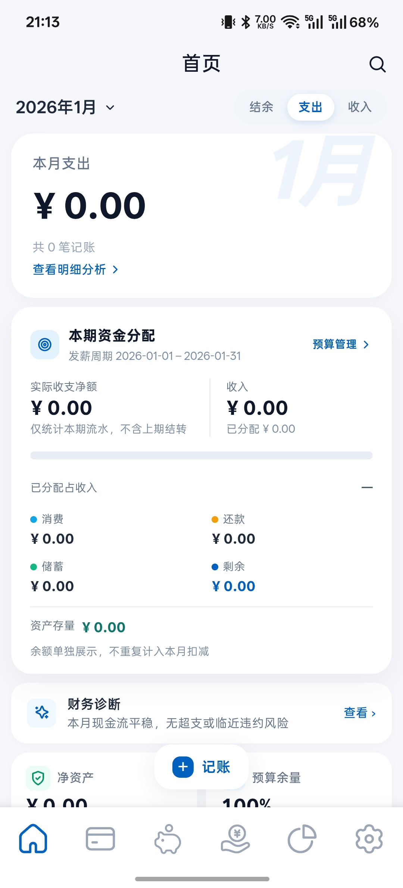
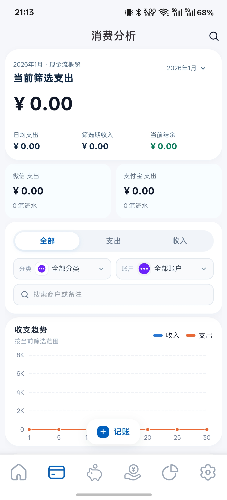
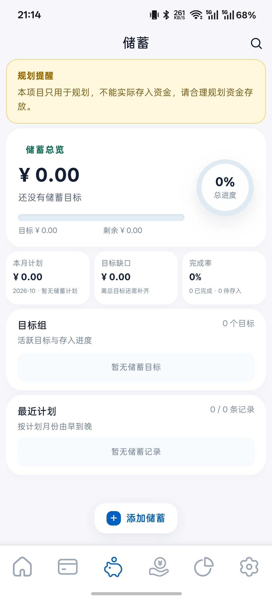
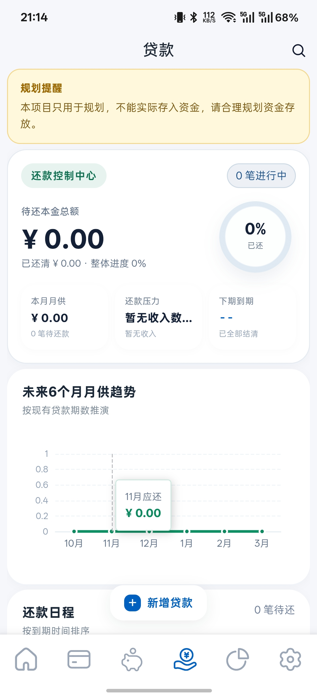
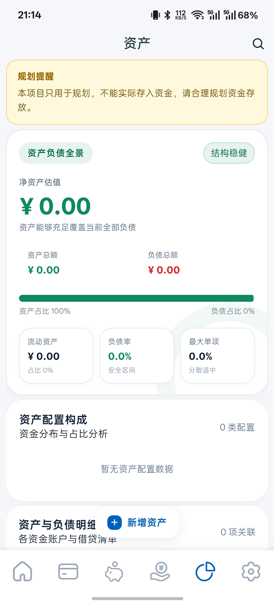
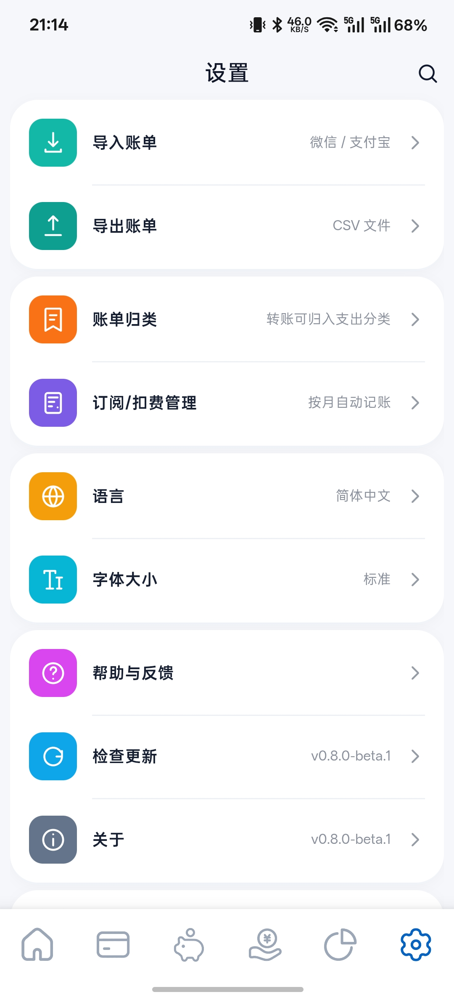

# 星会计（Wotty Star Accounting）

<p align="center"></p>

<p align="center">
  <a href="https://github.com/sevencnup/wotty-StarAccounting/blob/master/LICENSE"></a>
  <a href="https://github.com/sevencnup/wotty-StarAccounting/releases"></a>
  <a href="https://github.com/sevencnup/wotty-StarAccounting/releases"></a>
  <a href="https://github.com/sevencnup/wotty-StarAccounting/stargazers"></a>
  <a href="https://github.com/sevencnup/wotty-StarAccounting/issues"></a>
</p>
<p align="center">
  <a href="docs/android-app-editions.md"></a>
  <a href="app/package.json"></a>
  <a href="app/package.json"></a>
  <a href="server-go/"></a>
  <a href="app/android/build.gradle"></a>
</p>

星会计是面向个人的记账与财务规划应用。记录收支后，可以按自然月或发薪周期查看资金变化，安排预算和储蓄计划，并管理资产、贷款及固定扣费。项目提供网页和 Android 版本。

## 主要功能

- **收支与账单**：记录收入、支出和账户流水，导入微信、支付宝账单，查看消费结构与趋势。
- **预算与资金分配**：按分类管理预算，结合薪资收入、计划支出和储蓄目标查看可支配金额。
- **储蓄、资产与贷款**：管理储蓄目标、资产余额和还款计划，并用相关账单核对计划执行情况。
- **订阅/扣费管理**：为订阅、保险、还款等固定支出设置日期和金额，到期自动记账。
- **本地与云端账本**：Android 可选择设备本地账本或登录云端账本；浏览器使用云端账本。

## 页面预览

以下为 Android `0.8.0-beta.1` 的空账本页面。点击图片可查看原尺寸。

<table>
  <tr><th>首页</th><th>消费分析</th><th>储蓄</th></tr>
  <tr>
    <td><a href="docs/screenshots/home.jpg"></a></td>
    <td><a href="docs/screenshots/consumption.jpg"></a></td>
    <td><a href="docs/screenshots/savings.jpg"></a></td>
  </tr>
  <tr><th>贷款</th><th>资产</th><th>设置</th></tr>
  <tr>
    <td><a href="docs/screenshots/loans.jpg"></a></td>
    <td><a href="docs/screenshots/assets.jpg"></a></td>
    <td><a href="docs/screenshots/settings.jpg"></a></td>
  </tr>
</table>

## 版本与数据模式

| 版本 | 页面与导航 | 本仓库能否构建 |
| --- | --- | --- |
| Web 壳版（`com.wotty.stark.web`） | Capacitor WebView 与网页底栏 | 可以 |
| KT 混合版（`com.wotty.stark.ktweb`） | 同一套网页页面与 Kotlin 原生底栏 | 可以 |

两个版本使用独立包名，可以同时安装。各版本的区别和构建命令见 [Android 安装包版本区分](docs/android-app-editions.md)。

Android 本地模式将数据保存在当前应用的 IndexedDB 中，不需要登录或部署服务器。云端模式通过 API 将数据保存在 MySQL 中，适合在多个设备上访问。两种模式使用独立账本，切换模式不会自动迁移、合并或同步数据。浏览器只支持云端模式。

## 仓库结构

| 目录 | 用途 |
| --- | --- |
| `app/` | 当前 Next.js 前端及 Capacitor Android 工程 |
| `server-go/` | Docker Compose 默认使用的 Go API |
| `api-server/` | 本地 `pnpm dev` 使用的 Ktor API |
| `docs/` | 开发、部署和版本说明 |
| `releases/` | 本地打包时保存带版本号和时间戳的 APK |

主要技术包括 Next.js 16、React 19、TypeScript、Capacitor 6、Kotlin、Go、MySQL 8 和 pnpm workspace。

## 本地开发

前端开发需要 Node.js 20.9 或更高版本和 pnpm；本地运行 Ktor API 还需要 Java 17，使用云端账本时需要 MySQL 8。Android 打包还需要 Android SDK。所有 Node 依赖都从仓库根目录安装：

```bash
pnpm install
cp .env.example .env
```

开发云端账本时，在 `.env` 中填写本机 MySQL 的 `DATABASE_URL`、`DB_USER`、`DB_PASSWORD`，并设置 `JWT_SECRET`。`ACCOUNT_ADMIN_KEY` 用于密码找回和注册开关。随后运行：

```bash
pnpm dev
```

此命令同时启动 Next.js 前端和 Ktor API。默认地址为 Web `http://127.0.0.1:12366`、API `http://127.0.0.1:12367`；端口被占用时，启动脚本会输出实际使用的端口。只调试 Android 本地模式时，可以跳过数据库配置，但 API 的数据接口无法使用。

Android 安装包内的 `localhost` 指手机本身。使用云端模式时，应填写 API 服务器的局域网地址或 HTTPS 域名，而不是电脑上的 `localhost`。

## Docker Compose 部署

根目录的 Compose 文件会启动 MySQL、Go API 和 Web。复制 `.env.example` 后，至少修改数据库密码、`JWT_SECRET` 和 `ACCOUNT_ADMIN_KEY`；首次使用内置 MySQL 时将 `DATABASE_URL` 留空：

```bash
cp .env.example .env
docker compose up -d --build
```

Web 默认绑定宿主机 `127.0.0.1:12366`，API 默认监听 `12367`，MySQL 默认只通过 `127.0.0.1:3307` 暴露。对外访问 Web 时，需要按部署环境配置反向代理。数据库使用 `mysql-data` 命名卷；更新容器前请备份账本数据。[数据库配置与部署说明](docs/database-config.md)提供了更多细节。

## Android 打包

在仓库根目录执行以下命令；打包过程会构建网页、同步 Capacitor 资源，再生成 APK：

| 版本 | Windows | Linux |
| --- | --- | --- |
| Web 壳版 | `pnpm --dir app apk` | `pnpm --dir app apk:linux` |
| KT 混合版 | `pnpm --dir app apk:ktweb` | `pnpm --dir app apk:ktweb:linux` |

新 Web 壳和 KT 混合版 APK 会按版本和时间戳另存到 `releases/`，保留旧包。Android `versionCode` 随新安装包单独递增。

## 数据与凭据

- 卸载 Android 应用或清除应用数据可能删除该版本的本地账本；请自行备份重要数据。
- 云端账本依赖 MySQL 数据卷；更新和迁移服务器前应备份数据库。
- `.env`、数据库密码、`JWT_SECRET` 和管理员密钥不能提交到 Git。

## 更多文档

- [更新日志](CHANGELOG.md)
- [开发迭代记录](docs/version-history.md)
- [Android Live Reload](docs/android-live-reload.md)
- [Android APK 构建记录](docs/android-apk-build-development.md)
